

  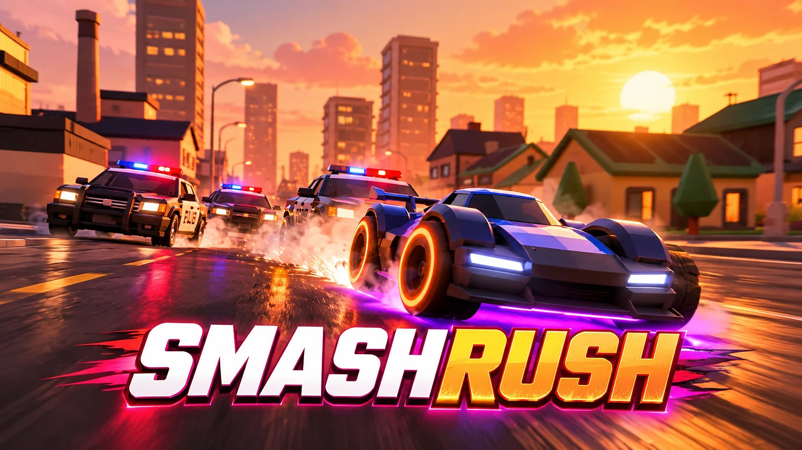

<h1 align="center">Smash Rush</h1>

  <b>Heist. Chase. Destroy.</b> 
  An arcade car-chase game for your browser: pull off jobs, outrun the cops and smash everything in your way.

  

  <a href="https://playgama.ai/play/52uzl3cmybfyg5"><b>playgama.ai/play/52uzl3cmybfyg5</b></a> 
  Free, no download, no sign-up. Best on a PC with a keyboard.

---

## Trailer

  <a href="media/trailer-landscape-1920x1080.mp4">
    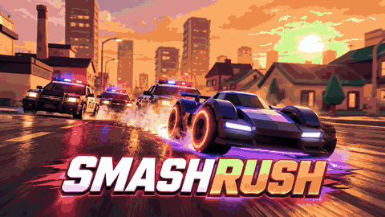
  </a>
   
  Click the preview to watch the full trailer.

  🎬 <a href="media/trailer-landscape-1920x1080.mp4"><b>Trailer (landscape, 1920×1080)</b></a>
  &nbsp;•&nbsp;
  📱 <a href="media/trailer-portrait-1080x1620.mp4"><b>Trailer (portrait, 1080×1620)</b></a>

---

## What's in the game

- **30-level career** in three chapters (Small Time, Big League, Most Wanted). Every level is a short job with a clear goal and up to three stars:
  - **Hot Getaway**: shake off the cops and reach the safehouse.
  - **Street Race**: beat rival drivers through checkpoints and finish on the podium.
  - **Takedown**: chase down a fleeing car and wreck it.
  - **Cop Hunt**: smash a set number of police cars against the clock.
  - **Bank Job**: drive to the bank, hold the zone while the vault cracks, lose the heat, get to the safehouse.
- **Police that hunt in squads**: they tail you and try PIT spins, pull alongside to sideswipe, cut you off with brake-checks, box you in when you slow down, and bring roadblocks, spike strips, SWAT trucks and a helicopter as the heat rises to five stars.
- **Route line on the road**: glowing chevrons show the way in races and to every destination.
- **Smash for time and cash**: wrecking cops extends the clock, and near misses, drifts and combos pay out.
- **Five-star rocket strike**: aim through a sniper scope, then watch the missile fly in slow motion.
- **Free Roam**: explore the city at your own pace and hunt for hidden loot (or take to the air once you own the attack chopper).
- **Garage** with cars to unlock and paint, a **stunt park** with ramps and hoops, **daily rewards**, daily challenges and **awards**.
- A living city with traffic, a **day/night cycle** and **dynamic weather**.

---

## Controls

| Action | Keys |
|---|---|
| Gas / brake & reverse | **W** / **S** |
| Steer | **A** / **D** |
| Drift | **Space** (or **S** + steer) |
| Nitro | **Shift** |
| Change camera | **C** |
| Rocket launcher (when loaded) | **R**, then **Space** to launch |
| Pause | **Esc** |

Prefer to just steer? Switch on **Auto-Drive** in the main menu and the car accelerates for you.

---

## Gameplay

  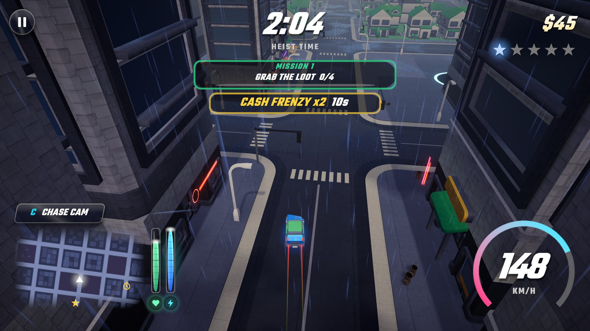

  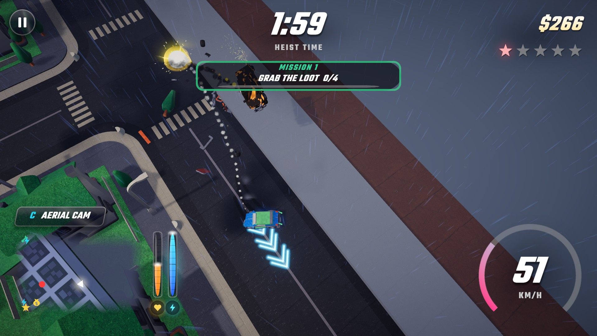
  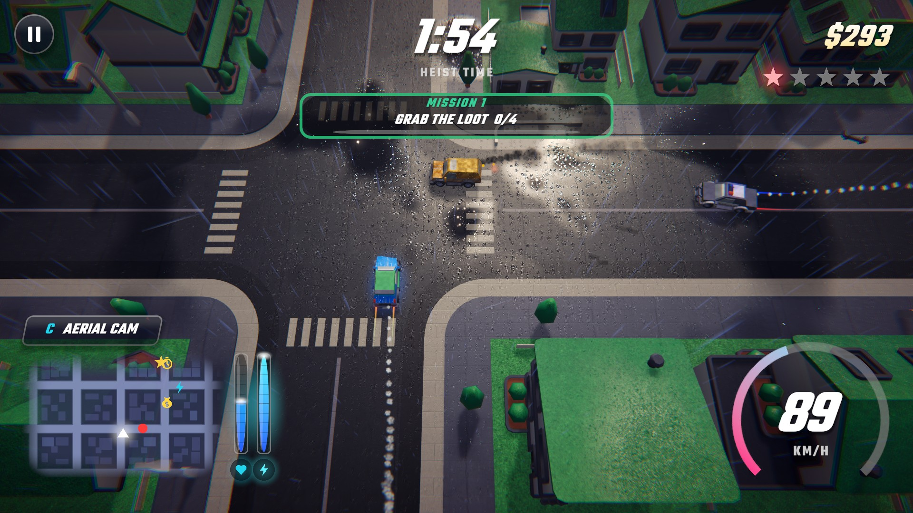

  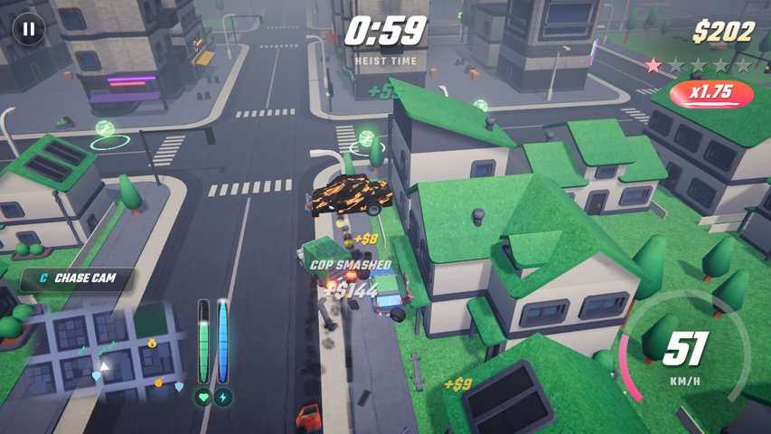
  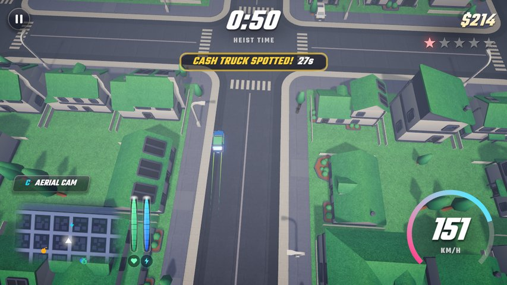
  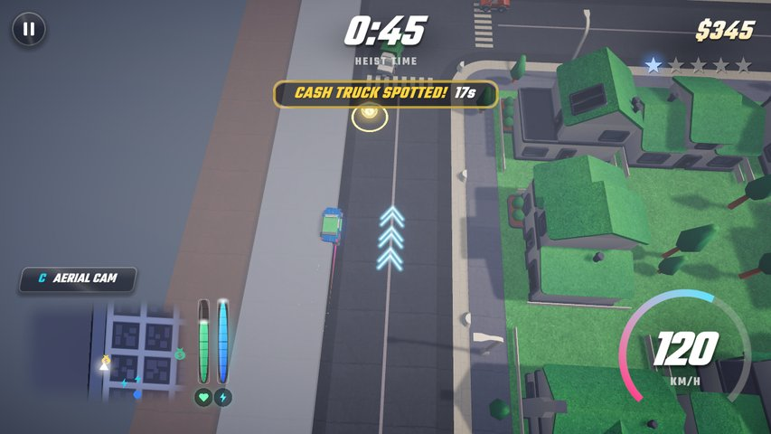

### Gameplay clips

Raw gameplay footage, the takes the trailers were cut from:

| Clip | Landscape | Portrait |
|---|---|---|
| City chase | [city-landscape.mp4](media/clips/city-landscape.mp4) | [city-portrait.mp4](media/clips/city-portrait.mp4) |
| Arena | [arena-landscape.mp4](media/clips/arena-landscape.mp4) | [arena-portrait.mp4](media/clips/arena-portrait.mp4) |

---

## Images

  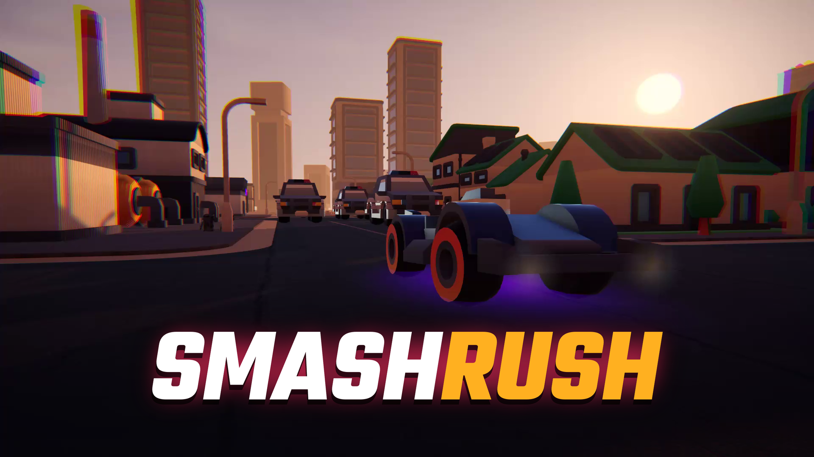

  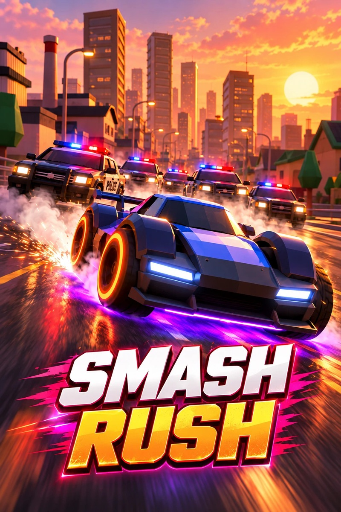
  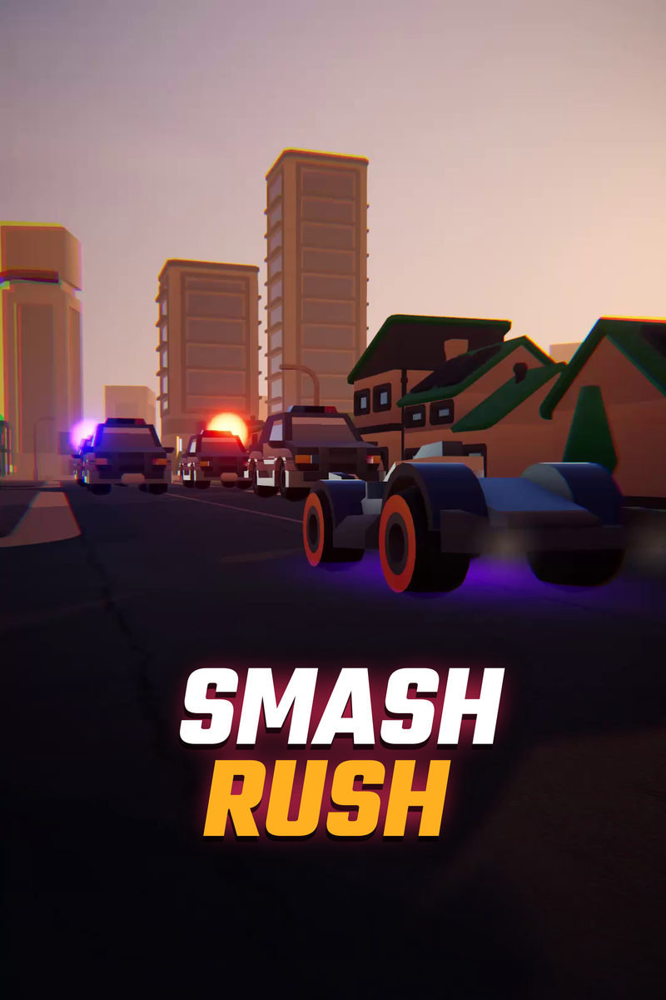
  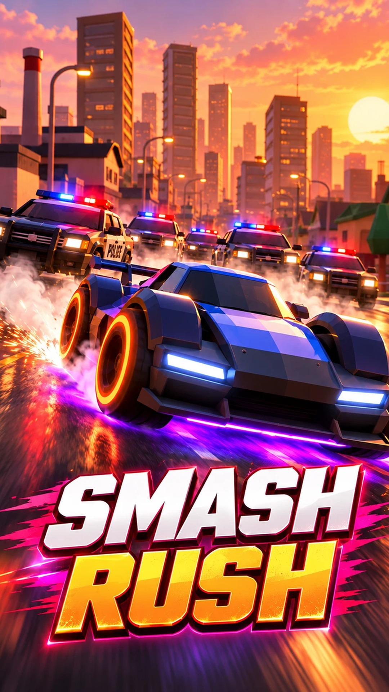

  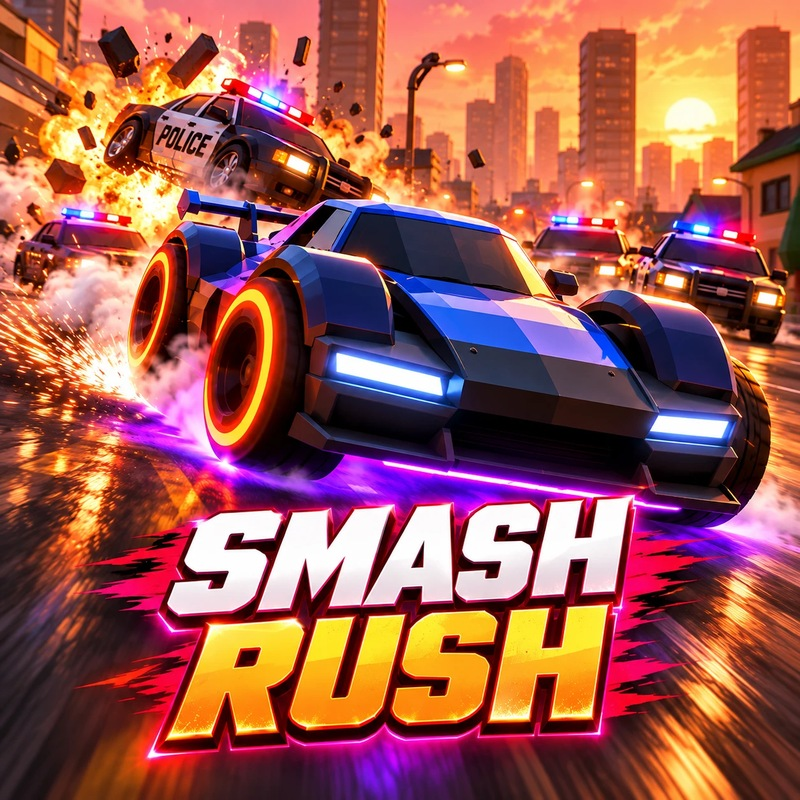
  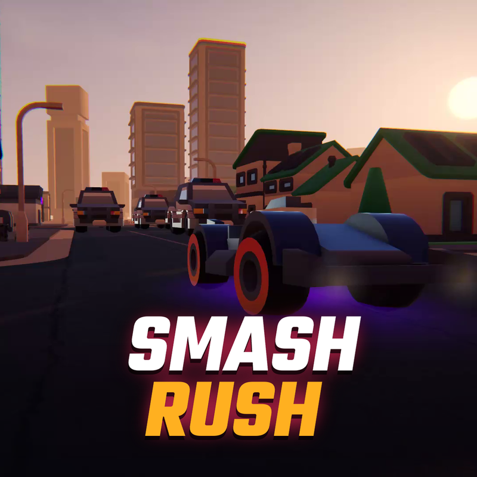

---

## Press kit

Every cover and thumbnail used on the game portals is in [`media/`](media):

- [`media/images/`](media/images): key art and in-game covers (1920×1080, 1080×1920, 800×1200, 800×800)
- [`media/press-kit/`](media/press-kit): portal thumbnails (1280×720, 1280×550, 512×512, 512×384, 200×120, 630×500)
- Trailers: [landscape](media/trailer-landscape-1920x1080.mp4) and [portrait](media/trailer-portrait-1080x1620.mp4)

---

## Built with

- **Unity 6** (Universal Render Pipeline), exported to **WebGL**
- **Playgama Bridge** SDK for the web release

### Credits

- 3D city, car and prop models: [Kenney](https://kenney.nl) (CC0) and [Poly Haven](https://polyhaven.com) (CC0)
- Music: [Uppbeat](https://uppbeat.io)

---

  <a href="https://playgama.ai/play/52uzl3cmybfyg5"><b>▶ Play Smash Rush</b></a>
    
  © Smash Rush. All rights reserved. This repository is the game's public page; the source code is private.

